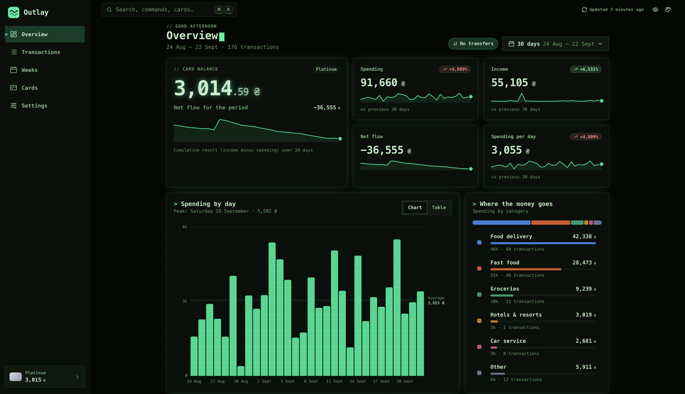
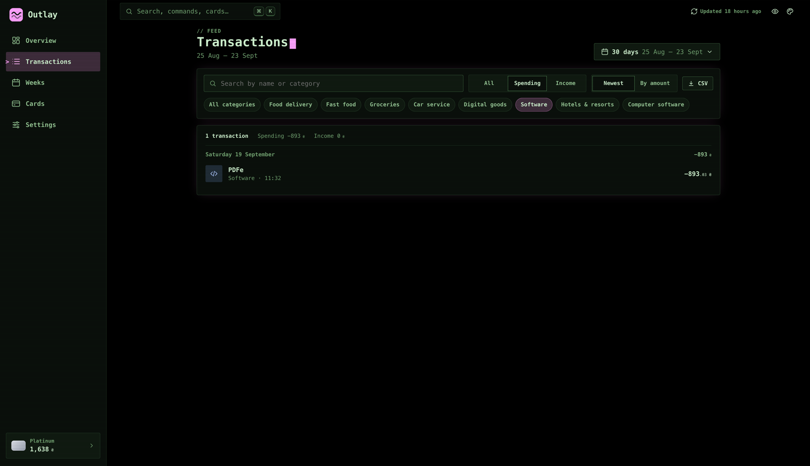
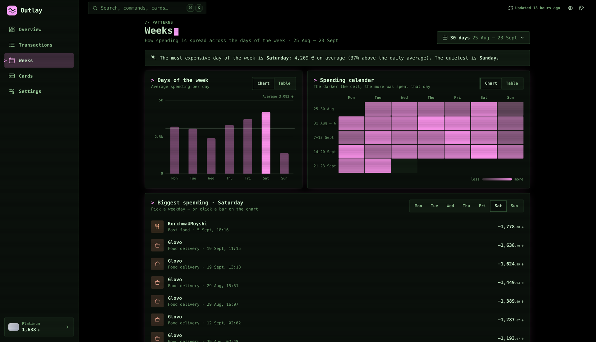
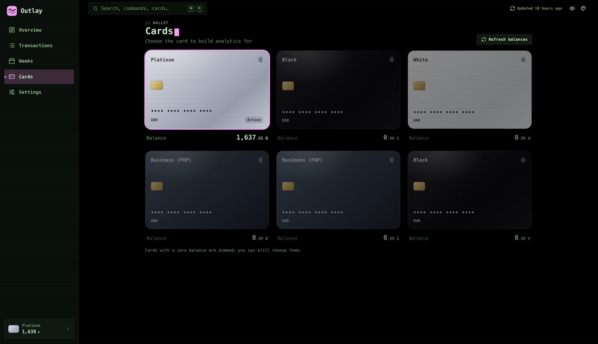
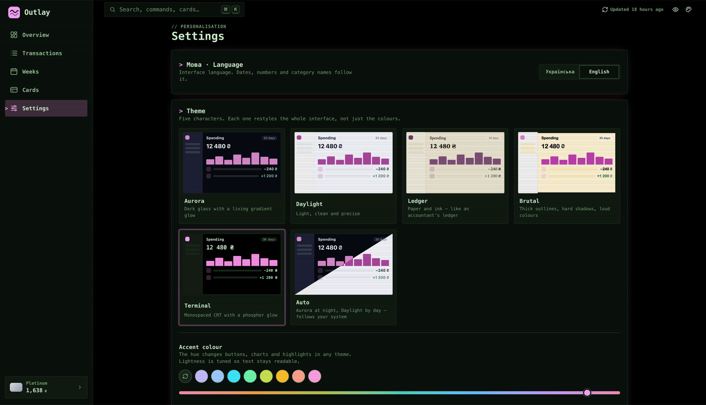
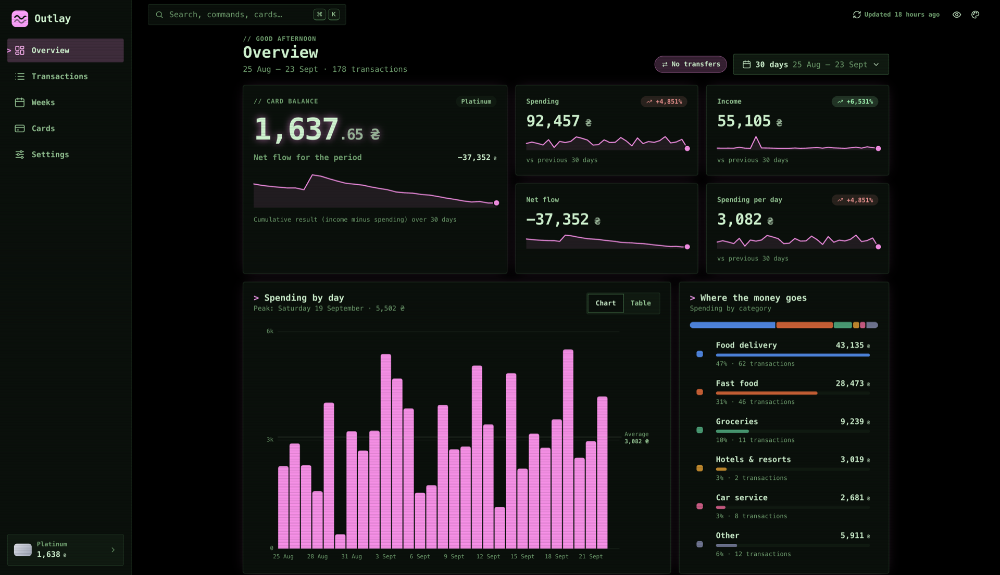

# Outlay

Outlay is a personal spending analytics app for Monobank cards. It pulls card statements from the Monobank API,
stores them in PostgreSQL and shows where the money goes: spending and income for any period compared with the
previous one, a breakdown by category, day-of-week patterns, a spending calendar and the largest purchases. New
transactions appear within seconds through the Monobank webhook.

This repository is the backend, an ASP.NET Core 10 Web API. The client is
[OutlayUI](https://github.com/dmitryspain/OutlayUI), an Angular 17 app that also runs on iPhone through Capacitor.

### What the backend does

- **Imports statements.** It loads recent transactions on demand and backfills months of history in the background.
  Monobank allows one statement request per minute, so every call goes through a shared rate limiter. Jobs are
  stored in the database and survive restarts.
- **Pushes live updates.** The Monobank webhook saves the transaction, Postgres `LISTEN/NOTIFY` carries the event
  between API instances, and the client receives it as server-sent events.
- **Keeps data private.** Every endpoint requires a session unless it is marked `[AllowAnonymous]`, and a client
  sees only their own cards. The Monobank token is encrypted at rest with ASP.NET Data Protection. Sign-in is
  rate-limited, CORS uses an explicit allow-list, and secrets live in user-secrets locally and in the host's
  environment variables in production.
- **Handles failures.** Domain events go through a transactional outbox processed by Quartz. The Monobank HTTP
  client has timeouts, a circuit breaker and retries for transient errors. It never retries a 429, because a quick
  retry only extends the bank's limit.

### Architecture

Clean Architecture with CQRS on MediatR:

| Project | Responsibility |
|---|---|
| `OutlayApp.Domain` | entities, `Result` / `Error`, repository interfaces, domain events; no infrastructure dependencies |
| `OutlayApp.Application` | commands, queries and their handlers, statement import, abstractions over Monobank, encryption and live events |
| `OutlayApp.Infrastructure` | EF Core + Npgsql, Monobank client, Quartz jobs, backfill worker, `LISTEN/NOTIFY`, Data Protection |
| `OutlayApp.API` | thin controllers, session authentication, card ownership filter, rate limiting, CORS |
| `OutlayApp.Tests` | xUnit tests |

**Stack:** .NET 10, ASP.NET Core, EF Core 10, PostgreSQL, MediatR, Autofac, Quartz.NET,
`Microsoft.Extensions.Http.Resilience`, xUnit. The Dockerfile is a multi-stage build on a chiseled .NET runtime image
that runs as a non-root user.

## Running locally

Secrets live in [user-secrets](https://learn.microsoft.com/aspnet/core/security/app-secrets), never in `appsettings.json`:

```bash
cd OutlayApp.API
dotnet user-secrets set "ConnectionStrings:Database" "Host=localhost;Port=5432;Database=outlayappapi_db_1;Username=postgres;Password=postgres"
dotnet user-secrets set "GoogleApi:SearchKey" "<key>"          # optional: merchant logos
dotnet user-secrets set "GoogleApi:SearchEngineId" "<id>"
dotnet tool restore                                             # dotnet-ef 10 from .config/dotnet-tools.json
ASPNETCORE_ENVIRONMENT=Development dotnet ef database update --context OutlayContext --project ../OutlayApp.Infrastructure --startup-project .
dotnet run --launch-profile https
```

- **Sign-in.** The UI sends the Monobank token once to `POST /api/auth/session` and gets a session token
  (`Authorization: Bearer ots_…`). The Monobank token is stored encrypted (ASP.NET Data Protection, keys in the
  database) and looked up by its SHA-256. Every other endpoint needs the session and only sees the client's own cards.
- **CORS.** Allowed origins come from `Cors:Origins` (`appsettings.Development.json` allows `localhost:4200/4300`
  and the iOS app's `capacitor://localhost`, see below).
- **Live updates (optional).** Monobank must reach the API over public https — for development a tunnel works, e.g.
  `cloudflared tunnel --url https://localhost:7016 --no-tls-verify` — then set `Monobank:WebhookBaseUrl` to the tunnel
  URL and `Monobank:WebhookSecret` to any random string, and press "Turn on" in the UI settings. Events reach the
  browser as server-sent events and travel between instances through Postgres `LISTEN/NOTIFY`.
- **History.** `POST /api/transactions/backfill?cardId=…&months=6` loads older statements in the background
  (one request per minute, as the bank allows); `POST /api/transactions/resync?cardId=…&days=31` re-reads recent
  days. Jobs are stored in the database and survive restarts.
- **Time and money.** Dates are stored and returned in UTC (`timestamptz`); dates sent without an offset are read as
  Kyiv time. All amounts and balances are in whole currency units.

```bash
dotnet test   # OutlayApp.Tests
```

### Доступ з телефона (iOS)

iOS-застосунок — це UI з OutlayUI-latest у нативній оболонці Capacitor. Його WebView шле запити з origin
`capacitor://localhost`, тому цей origin додано до `Cors:Origins` у `appsettings.Development.json`. Без нього WebView
відкидає всі відповіді API, включно з 401 і SSE, і UI бачить «немає мережі» замість «сесія закінчилась».

- **(а) Лише HTTPS.** iOS (App Transport Security) пускає застосунок тільки на HTTPS-адресу з довіреним сертифікатом.
- **(б) Симулятор** бачить `https://localhost:7016` Мака, але має довіряти dev-сертифікату ASP.NET Core. Запустіть
  симулятор і додайте сертифікат до його довірених кореневих:
  ```bash
  dotnet dev-certs https --export-path ~/outlay-dev.crt --format PEM
  xcrun simctl keychain booted add-root-cert ~/outlay-dev.crt
  ```
  Для іншого симулятора або нового dev-сертифіката команди треба повторити.
- **(в) Фізичний iPhone** ходить на задеплоєний API (`https://outlay-api.onrender.com/api` у
  `environment.mobile.ts`, розділ «Deployment»). `localhost` Мака йому недоступний. Quick-тунель `cloudflared`
  (`*.trycloudflare.com`) для застосунку не годиться: адреса змінюється при кожному запуску, а SSE він не підтримує
  ([документація Cloudflare](https://developers.cloudflare.com/tunnel/get-started/quick-tunnels/)).
- **(г) Production.** `capacitor://localhost` уже є в `Cors:Origins` файлу `appsettings.Production.json`.
- **(ґ) Origin — не автентифікація.** Доступ і далі дає лише Bearer-сесія (для SSE — той самий токен у
  `?access_token=`). Cookies не використовуються, тож CSRF-ризику немає.

## Deployment

Free tiers, no bank card: the UI on **Cloudflare Pages**, the API on **Render** (Free web service, Docker, Frankfurt),
the database on **Neon** (Free, AWS Europe Central 1). A push to `master` deploys both apps.

| What | Address | Settings |
|---|---|---|
| UI | `https://outlay.pages.dev` | build `npm run build`, output `dist/outlay-ui`, Node from `.node-version` |
| API | `https://outlay-api.onrender.com` | Dockerfile `./OutlayApp.API/Dockerfile`, context `.`, health check `/api/health` |
| Database | Neon project `outlay`, database `outlay` | direct endpoint, compute fixed at 0.25 CU |

**Configuration.** Everything that is not a secret is in git, so tests check it: `appsettings.Production.json`
(CORS for the UI and the iOS app, client IP from `CF-Connecting-IP`, the webhook's public URL) and the UI's
`environment.production.ts` / `environment.mobile.ts`. Render holds only the variables:

| Variable | Value |
|---|---|
| `PORT` | `8080`, the port the image listens on (the chiseled image has no shell to read Render's default) |
| `ConnectionStrings__Database` | the app role's connection string, see below |
| `Monobank__WebhookSecret` | a random string (`openssl rand -hex 32`); changing it means turning the webhook on again |
| `GoogleApi__SearchKey`, `GoogleApi__SearchEngineId` | optional, merchant logos |

Key Vault is used only when `KeyVault:ClientSecretId` is set, so Production starts without Azure.

**Database.**
- **Direct endpoint only, no `-pooler`.** Live events use `LISTEN`, which does not work through PgBouncer.
- **Key-value connection string** (Npgsql does not read the `postgresql://` URI):
  `Host=ep-….eu-central-1.aws.neon.tech;Database=outlay;Username=outlay_app;Password=…;SSL Mode=VerifyFull;Channel Binding=Require;Connection Idle Lifetime=60`.
- **Two roles.** The owner (`neondb_owner`) applies migrations from the developer's terminal. Render gets
  `outlay_app`, which has data rights only, no DDL. Run this as the owner after the migrations:
  ```sql
  CREATE ROLE outlay_app WITH LOGIN PASSWORD '<openssl rand -hex 24>';
  GRANT CONNECT ON DATABASE outlay TO outlay_app;
  GRANT USAGE ON SCHEMA public TO outlay_app;
  GRANT SELECT, INSERT, UPDATE, DELETE ON ALL TABLES IN SCHEMA public TO outlay_app;
  GRANT USAGE, SELECT, UPDATE ON ALL SEQUENCES IN SCHEMA public TO outlay_app;
  ALTER DEFAULT PRIVILEGES IN SCHEMA public GRANT SELECT, INSERT, UPDATE, DELETE ON TABLES TO outlay_app;
  ALTER DEFAULT PRIVILEGES IN SCHEMA public GRANT USAGE, SELECT, UPDATE ON SEQUENCES TO outlay_app;
  ```
- **Migrations go first.** Apply a new migration to Neon **before** pushing the code that needs it, because Render
  deploys right after the push:
  ```bash
  read -rs "NEON_OWNER?Neon owner connection string: "; echo
  cd OutlayApp.API && ConnectionStrings__Database="$NEON_OWNER" ASPNETCORE_ENVIRONMENT=Development \
    dotnet ef database update --context OutlayContext --project ../OutlayApp.Infrastructure --startup-project .
  unset NEON_OWNER
  ```

**Free-tier limits.**
- **Render sleeps after 15 minutes without requests** and wakes in about a minute. The 750 free hours a month are
  shared by every free service in the workspace.
- **Neon stays awake while the API is up.** The outbox job queries the database every 10 seconds. Neon Free gives
  100 CU-hours a month, which is about 400 hours at 0.25 CU. So there is **no keep-alive pinger**: running 24/7 needs
  about 180 CU-hours. An open UI tab also keeps the API awake (SSE reconnects and the balance poll).
- **The webhook survives a cold start.** Monobank waits 5 s and retries after 60 and 600 s. The first push wakes the
  API and the retry lands on a warm one. Only after three failures does the bank turn the webhook off; in that case
  turn it on again in Settings.

## Screenshots

**Overview.** Card balance, spending and income against the previous period, spending by day and by category.



**Transactions.** Search, filters by type and category, sorting and CSV export.



**Weeks.** Average spending per weekday, a spending calendar and the largest purchases on the chosen day.



**Cards.** Every card on the account; the selected one feeds all the analytics.



**Settings.** Ukrainian or English, five themes plus Auto, and any accent colour.



**Accent colour.** The same Overview in the Terminal theme with a pink accent.


