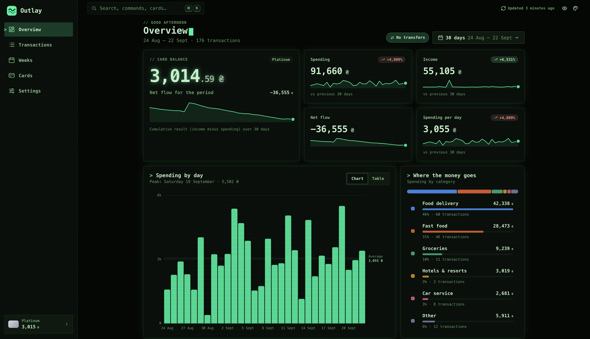
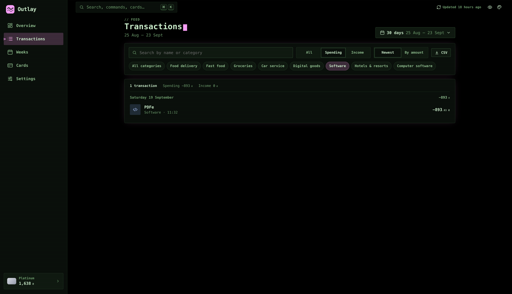
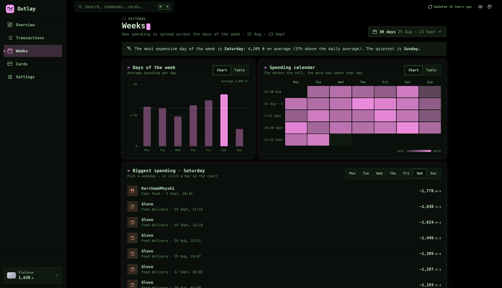
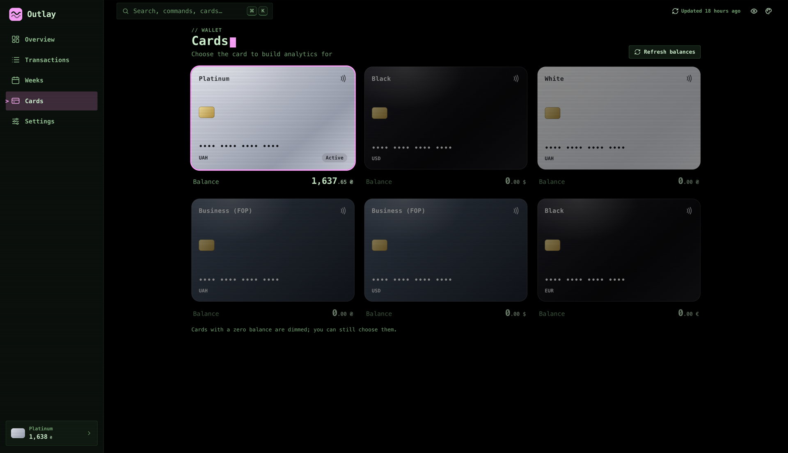
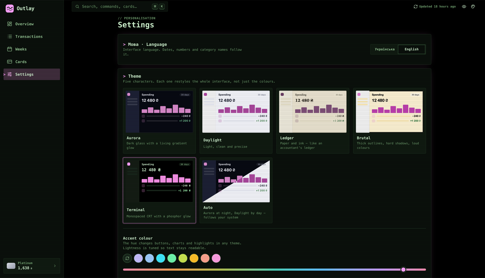
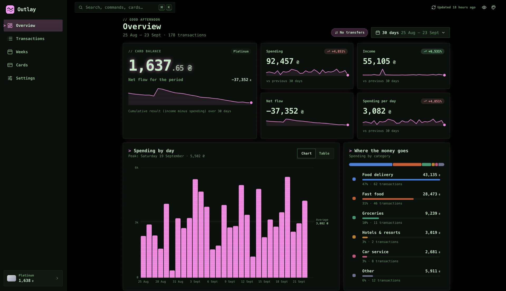

# Outlay

Outlay is a personal spending analytics app for Monobank cards. It pulls card statements from the Monobank API,
stores them in PostgreSQL and shows where the money goes: spending and income for any period compared with the
previous one, a breakdown by category, day-of-week patterns, a spending calendar and the largest purchases. New
transactions appear within seconds through the Monobank webhook.

This repository is the backend, an ASP.NET Core 8 Web API. The client is
[OutlayUI](https://github.com/ChaklunIvan/OutlayUI), an Angular 17 app that also runs on iPhone through Capacitor.

### What the backend does

- **Imports statements.** It loads recent transactions on demand and backfills months of history in the background.
  Monobank allows one statement request per minute, so every call goes through a shared rate limiter. Jobs are
  stored in the database and survive restarts.
- **Pushes live updates.** The Monobank webhook saves the transaction, Postgres `LISTEN/NOTIFY` carries the event
  between API instances, and the client receives it as server-sent events.
- **Keeps data private.** Every endpoint requires a session unless it is marked `[AllowAnonymous]`, and a client
  sees only their own cards. The Monobank token is encrypted at rest with ASP.NET Data Protection. Sign-in is
  rate-limited, CORS uses an explicit allow-list, and secrets live in user-secrets or Azure Key Vault.
- **Handles failures.** Domain events go through a transactional outbox processed by Quartz. The Monobank HTTP
  client has timeouts, a circuit breaker and retries for transient errors. It never retries a 429, because a quick
  retry only extends the bank's limit.

### Architecture

Clean Architecture with CQRS on MediatR:

| Project | Responsibility |
|---|---|
| `OutlayApp.Domain` | entities, `Result` / `Error`, repository interfaces, domain events; no infrastructure dependencies |
| `OutlayApp.Application` | commands, queries and their handlers, statement import, abstractions over Monobank, encryption and live events |
| `OutlayApp.Infrastructure` | EF Core + Npgsql, Monobank client, Quartz jobs, backfill worker, `LISTEN/NOTIFY`, Data Protection |
| `OutlayApp.API` | thin controllers, session authentication, card ownership filter, rate limiting, CORS |
| `OutlayApp.Tests` | xUnit tests |

**Stack:** .NET 8, ASP.NET Core, EF Core 8, PostgreSQL, MediatR, Autofac, Quartz.NET,
`Microsoft.Extensions.Http.Resilience`, xUnit. The Dockerfile is a multi-stage build on a chiseled .NET runtime image
that runs as a non-root user.

## Running locally

Secrets live in [user-secrets](https://learn.microsoft.com/aspnet/core/security/app-secrets), never in `appsettings.json`:

```bash
cd OutlayApp.API
dotnet user-secrets set "ConnectionStrings:Database" "Host=localhost;Port=5432;Database=outlayappapi_db_1;Username=postgres;Password=postgres"
dotnet user-secrets set "GoogleApi:SearchKey" "<key>"          # optional: merchant logos
dotnet user-secrets set "GoogleApi:SearchEngineId" "<id>"
ASPNETCORE_ENVIRONMENT=Development dotnet ef database update --context OutlayContext --project ../OutlayApp.Infrastructure --startup-project .
dotnet run --launch-profile https
```

- **Sign-in.** The UI sends the Monobank token once to `POST /api/auth/session` and gets a session token
  (`Authorization: Bearer ots_…`). The Monobank token is stored encrypted (ASP.NET Data Protection, keys in the
  database) and looked up by its SHA-256. Every other endpoint needs the session and only sees the client's own cards.
- **CORS.** Allowed origins come from `Cors:Origins` (`appsettings.Development.json` allows `localhost:4200/4300`
  and the iOS app's `capacitor://localhost`, see below).
- **Live updates (optional).** Monobank must reach the API over public https — for development a tunnel works, e.g.
  `cloudflared tunnel --url https://localhost:7016 --no-tls-verify` — then set `Monobank:WebhookBaseUrl` to the tunnel
  URL and `Monobank:WebhookSecret` to any random string, and press "Turn on" in the UI settings. Events reach the
  browser as server-sent events and travel between instances through Postgres `LISTEN/NOTIFY`.
- **History.** `POST /api/transactions/backfill?cardId=…&months=6` loads older statements in the background
  (one request per minute, as the bank allows); `POST /api/transactions/resync?cardId=…&days=31` re-reads recent
  days. Jobs are stored in the database and survive restarts.
- **Time and money.** Dates are stored and returned in UTC (`timestamptz`); dates sent without an offset are read as
  Kyiv time. All amounts and balances are in whole currency units.

```bash
dotnet test   # OutlayApp.Tests
```

### Доступ з телефона (iOS)

iOS-застосунок — це UI з OutlayUI-latest у нативній оболонці Capacitor. Його WebView шле запити з origin
`capacitor://localhost`, тому цей origin додано до `Cors:Origins` у `appsettings.Development.json`. Без нього WebView
відкидає всі відповіді API, включно з 401 і SSE, і UI бачить «немає мережі» замість «сесія закінчилась».

- **(а) Лише HTTPS.** iOS (App Transport Security) пускає застосунок тільки на HTTPS-адресу з довіреним сертифікатом.
- **(б) Симулятор** бачить `https://localhost:7016` Мака, але має довіряти dev-сертифікату ASP.NET Core. Запустіть
  симулятор і додайте сертифікат до його довірених кореневих:
  ```bash
  dotnet dev-certs https --export-path ~/outlay-dev.crt --format PEM
  xcrun simctl keychain booted add-root-cert ~/outlay-dev.crt
  ```
  Для іншого симулятора або нового dev-сертифіката команди треба повторити.
- **(в) Фізичному iPhone** `localhost` Мака недоступний, тож йому потрібна **стабільна** HTTPS-адреса бекенду з
  підтримкою SSE. Quick-тунель `cloudflared` (`*.trycloudflare.com`) для цього не годиться: адреса змінюється при
  кожному запуску, а SSE він не підтримує
  ([документація Cloudflare](https://developers.cloudflare.com/tunnel/get-started/quick-tunnels/)). Годиться він
  лише для вебхука Monobank і разових перевірок REST.
- **(г) Production.** Якщо колись буде production-деплой, `capacitor://localhost` треба додати до `Cors:Origins`
  через налаштування середовища (змінна `Cors__Origins__N`) або Key Vault (секрет `Cors--Origins--N`: Key Vault
  не допускає `_` в іменах, а провайдер конфігурації читає `--` як `:`). `N` — наступний вільний індекс у списку,
  починаючи з 0.
- **(ґ) Origin — не автентифікація.** Доступ і далі дає лише Bearer-сесія (для SSE — той самий токен у
  `?access_token=`). Cookies не використовуються, тож CSRF-ризику немає.

## Screenshots

**Overview.** Card balance, spending and income against the previous period, spending by day and by category.



**Transactions.** Search, filters by type and category, sorting and CSV export.



**Weeks.** Average spending per weekday, a spending calendar and the largest purchases on the chosen day.



**Cards.** Every card on the account; the selected one feeds all the analytics.



**Settings.** Ukrainian or English, five themes plus Auto, and any accent colour.



**Accent colour.** The same Overview in the Terminal theme with a pink accent.


